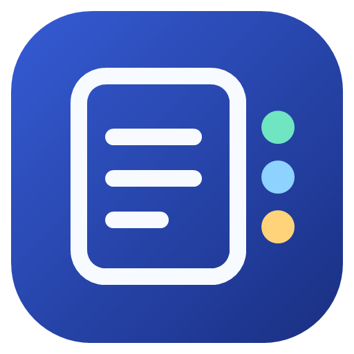

# 随记坞 · EventDock

随记坞是一个 Windows 桌面事件记录工具。点击屏幕边缘的细条即可打开事件面板，随手写下想法、粘贴截图或收集附件。记录保存在本机，应用可离线使用。

## 功能

- **贴边入口**。按今日事件数量显示圆点，点击查看今日、全部和归档列表。
- **快捷记录**。按 `Ctrl+Alt+N` 新建，编辑时自动保存草稿，按 `Ctrl+S` 完成编辑。
- **图文编辑**。支持截图粘贴、附件、标签、待办清单和简单表格。点击图片可全屏查看和缩放。
- **事件整理**。支持搜索、标记完成、归档和删除。
- **多语言**。可从右键菜单切换简体中文、英语和巴西葡萄牙语。

## 快速开始

在 Windows 上，从项目目录执行以下命令。开发启动已在 Node.js 20.10 上验证。

```powershell
npm ci
npm start
```

开发时可运行 `npm run dev`。Windows 打包使用 Node.js 22.12 或更高版本。`npm run build` 生成安装包和便携版，`npm run build:portable` 只生成便携版。输出位于 `dist/`。

## 使用

- 点击列表里的「+」或使用全局快捷键新建事件。关闭未完成的编辑后，可以重新打开草稿继续写。
- 单个附件上限 25 MiB。正文内联图支持 PNG、JPEG、GIF 和 WebP。
- `Ctrl+Alt+E` 展开或收起面板，`Ctrl+Alt+F` 搜索事件。发生快捷键冲突时，入口右键菜单显示实际注册的组合。
- 数据库在 `%APPDATA%\EventDock\data\events.db`，附件和设置分别位于同目录下的 `attachments/` 和 `settings.json`。旧版 EventDock 的记录可以直接读取。

## 开发资料

- [需求说明](docs/EventDock-需求说明.md)
- [界面参考图](docs/EventDock-界面参考.png)
- [GitHub 发布指南](docs/GitHub-发布指南.md)

新增语言时，在 `src/locales/` 下按 BCP 47 语言标签添加 UTF-8 JSON 文件，可参考 `en.json`。重启后自动发现新语言，缺失译文使用英语。

## 项目来源

本项目早期从 FelipeGazapina 的 Sticky Notes 源码工作区开始，随后分离为独立的 EventDock 项目。[原参考项目](https://github.com/FelipeGazapina/sticky-notes)
